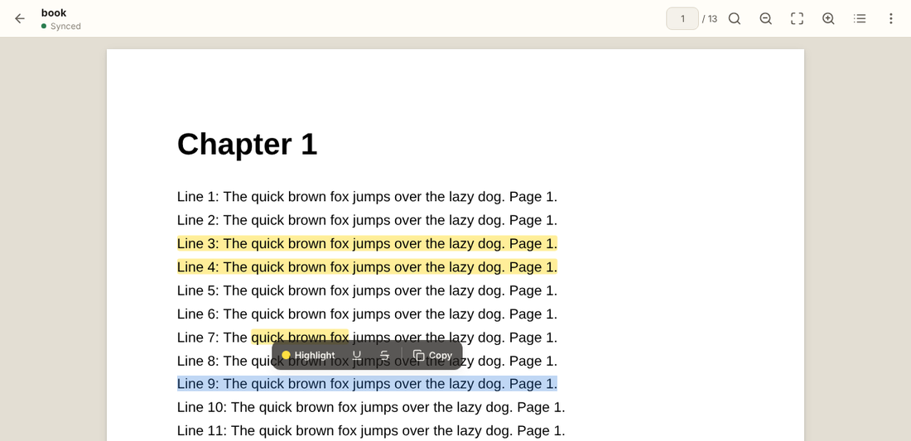
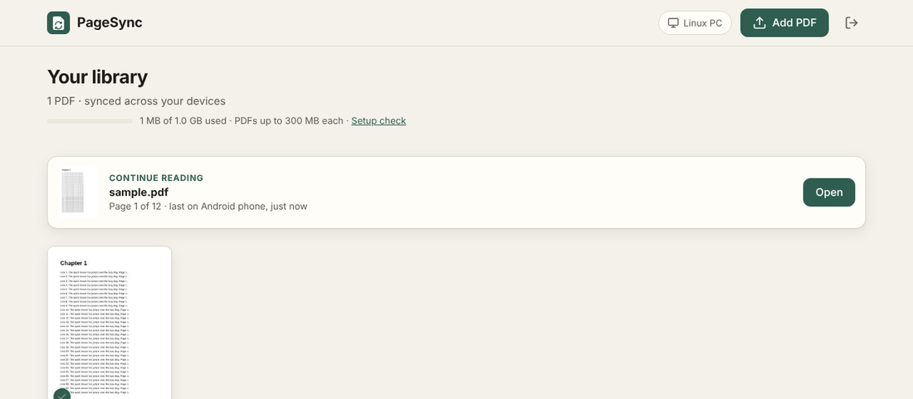
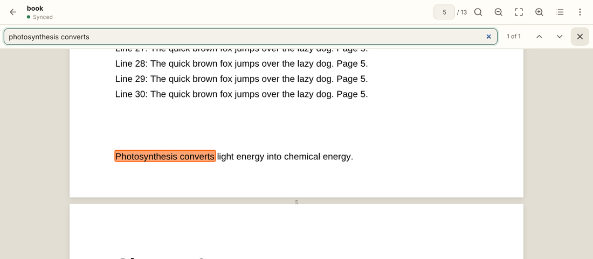
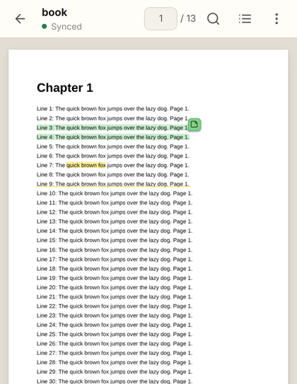
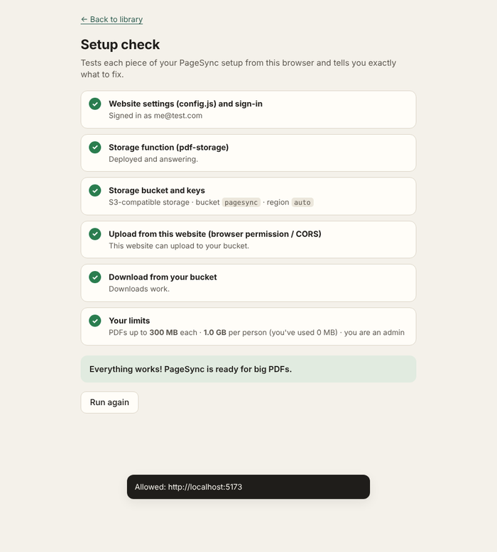

# PageSync

**A PDF reader that remembers everything across devices: your highlights, notes and the exact page you stopped on.**

🔗 **Live demo:** https://siddharthsinghpagesync.netlify.app/



## Why I built this

I study from a lot of PDFs, and I switch between my laptop and my phone all the time. Every app I tried had the same problems:

- highlights made on one device didn't show up on the other
- syncing the file through cloud storage created conflicting copies
- I always had to scroll around to find where I'd stopped

I wanted to mark up a PDF on my PC, pick up my phone, and **continue exactly where I left off**, even on a train with no signal. So I built PageSync.

It started as a small app running on my own computer. It's now a cloud app with accounts, so friends can use it too.

## Features

**Reading and marking up**
- **Text highlighting that snaps to the words.** Drag across a sentence and you get one clean highlight per line, as in a proper PDF reader. Highlight, underline or strikethrough, in any color.
- **Select text, then act on it:** select with the normal scroll tool and a small bar offers *Highlight · Underline · Strike · Copy*.
- **Notes on highlights.** Tap a highlight to recolor it, change its style, attach a note, copy its text or delete it (with undo).
- Freehand highlighter, pen, text boxes, sticky notes, area highlight (handy for scanned pages), eraser, undo/redo.
- **Search inside the PDF**, **table of contents** navigation and **night reading** mode.

**Syncing**
- **Live sync**: a change on one device appears on your others within about a second.
- **Resume where you stopped**: "Resumed on page 42 from Laptop".
- **Offline-first**: PDFs you've opened work without internet, and edits made offline upload by themselves when you reconnect.

**Sharing your work**
- **Download with your marks** as a normal PDF; notes become real PDF comments.
- **Export your notes** as Markdown: every highlight and comment, grouped by page.

**Accounts and storage**
- Sign up with email, reset a forgotten password, and keep your library private.
- PDFs up to **300 MB**, uploaded in 10 MB pieces that retry on bad connections.
- A storage quota per person, plus a built-in **setup check** page that diagnoses configuration problems.

## Screenshots

| Library | Search inside a PDF |
|---|---|
|  |  |

| On a phone | Setup check |
|---|---|
|  |  |

## How it works

```
 Browser / installed app  (static site on Netlify)
   │
   ├── Supabase Auth ........ sign up, sign in, password reset
   ├── Supabase Postgres .... documents + annotations, protected by Row Level Security
   ├── Supabase Realtime .... pushes every change to your other open devices
   └── Edge Function ........ checks login, file-size limit and quota → short-lived signed URLs
            │
            └── S3-compatible storage (Backblaze B2 / Cloudflare R2 / AWS S3)
                 the browser uploads and downloads PDFs directly with those signed URLs

 On each device: IndexedDB caches PDFs and annotations; a service worker caches the app itself.
```

### Design decisions

- **The PDF file is never modified.** Annotations are stored as small JSON records, with positions saved as fractions of the page so they line up at any zoom level and screen size. Syncing a highlight costs a few hundred bytes instead of re-uploading the whole file, and there are never "conflicted copies".
- **Conflicts are resolved per annotation.** The newest edit wins, using a server-side SQL function. Deletions leave a *tombstone*, so a device that was offline can't bring a deleted highlight back by accident; only an explicit undo can restore it.
- **Offline-first sync.** Every change goes into a local queue (localStorage) before it's sent. If the network drops, the queue retries, and on reconnect the app re-downloads the server state and replays anything still pending.
- **Text highlights snap to real text.** PDF.js renders an invisible text layer. I map pointer positions to characters with `caretPositionFromPoint`, then merge the character boxes into one rectangle per line.
- **Storage keys never reach the browser.** An Edge Function verifies the user and their quota, then signs AWS Signature V4 URLs (implemented by hand with Web Crypto and checked against AWS's official test vector) that are valid for one file in that user's folder only.
- **Quotas can't be faked.** The server measures file sizes, a database trigger stops users from editing a document's size or storage location, and uploads still in progress count toward the quota.

## Tech stack

- **Frontend:** HTML, CSS and vanilla JavaScript (ES modules, no framework or build step); installable PWA with service worker + IndexedDB
- **PDF:** [PDF.js](https://mozilla.github.io/pdf.js/) for rendering and the text layer; [pdf-lib](https://pdf-lib.js.org/) for exporting annotated PDFs
- **Backend:** [Supabase](https://supabase.com): PostgreSQL (Row Level Security, PL/pgSQL), Auth, Realtime, Edge Functions (Deno / TypeScript)
- **Storage:** S3-compatible object storage with presigned multipart uploads
- **Hosting:** Netlify

## Run your own copy

Everything runs on free tiers. The full step-by-step guide is in **[docs/SETUP.md](docs/SETUP.md)**. In short:

1. Create a Supabase project and run [`supabase/setup.sql`](supabase/setup.sql).
2. Create a storage bucket (Backblaze B2 needs no credit card).
3. Deploy [`supabase/functions/pdf-storage`](supabase/functions/pdf-storage/index.ts) and add your storage keys as secrets.
4. Put your Supabase URL and publishable key in [`public/config.js`](public/config.js).
5. Deploy the `public/` folder to Netlify, then open `/check.html` to verify everything.

To preview locally, run `node serve.js` and open http://localhost:5173.

## Project structure

```
pagesync/
├── public/                        the website (deployed to Netlify)
│   ├── index.html, js/library.js  library, uploads, storage meter
│   ├── viewer.html, js/viewer.js  reader: rendering, tools, text highlights, search, sync, export
│   ├── login.html, reset.html     sign up, sign in, password reset
│   ├── check.html                 setup diagnostics
│   ├── js/backend.js              cloud calls + offline cache
│   ├── sw.js                      service worker (offline app)
│   └── vendor/                    PDF.js and pdf-lib
├── supabase/
│   ├── setup.sql                  tables, security rules, sync function, quotas
│   └── functions/pdf-storage/     Edge Function: signed URLs, limits, quotas
├── docs/                          setup guide and screenshots
└── serve.js                       local preview server
```

## Keyboard shortcuts

`H` scroll · `L` highlight text · `A` area highlight · `M` freehand highlighter · `P` pen · `T` text · `N` note · `E` eraser · `Ctrl+F` search · `Ctrl+Z` / `Ctrl+Shift+Z` undo/redo

## Roadmap

- [ ] Sign in with Google
- [ ] Folders and tags for the library
- [ ] Share a PDF (with its highlights) with another user
- [ ] Turn highlights into flashcards for revision
- [ ] "Make available offline" for a whole folder before a trip

## Author

**Siddharth Singh**
GitHub: [@SiddharthSingh726](https://github.com/SiddharthSingh726) · LinkedIn: www.linkedin.com/in/siddharth-singh-530440379

If you find a bug or have an idea, feel free to open an issue.

## License

[MIT](LICENSE)
